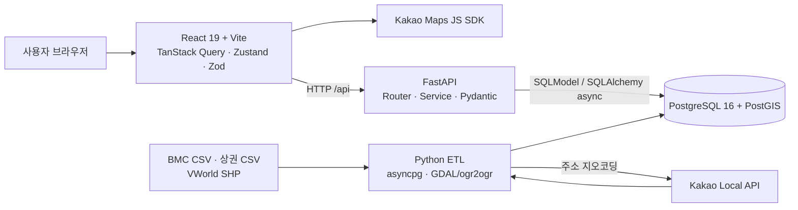
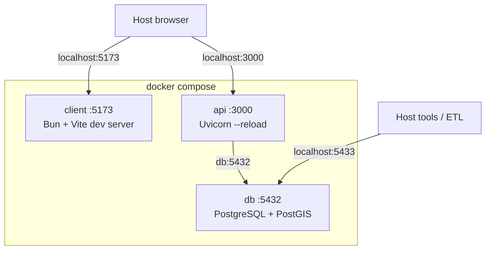
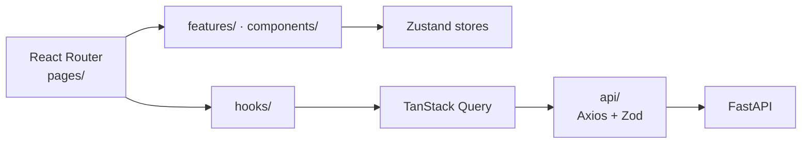
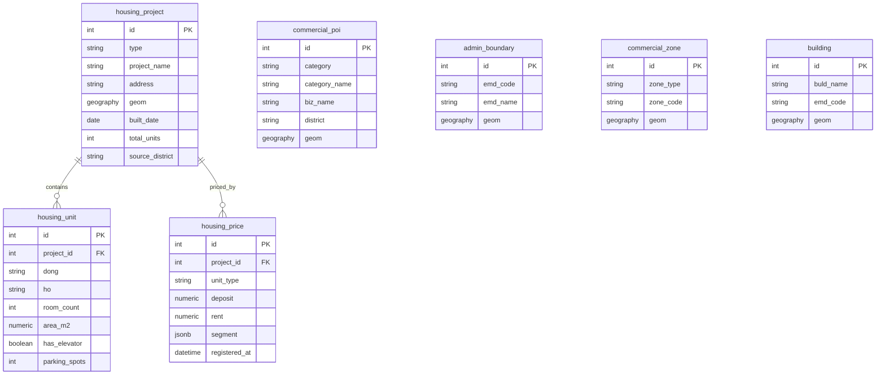
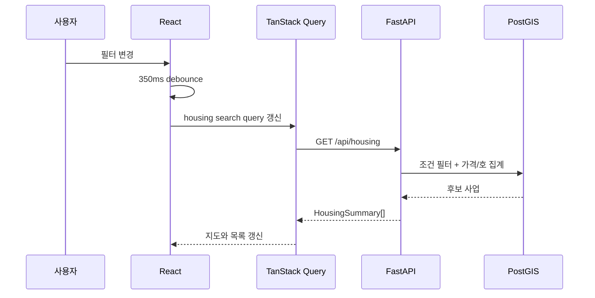
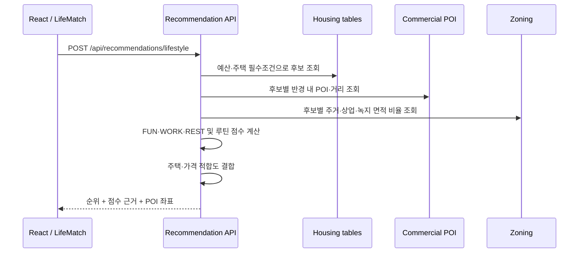
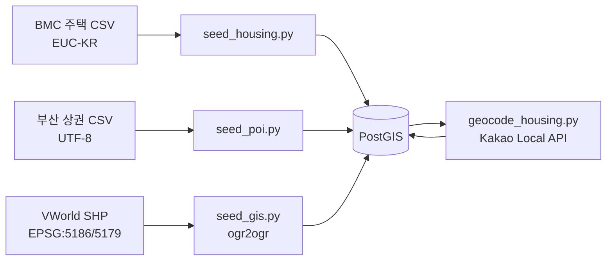

# DIVE 2026 프로젝트 아키텍처

이 문서는 현재 `sangwon` 브랜치의 실제 코드를 기준으로 제품 목적, 주요 기능,
시스템 구성, 데이터 흐름, 추천 로직과 운영 방법을 한곳에 정리한 문서다.

세부 구현 위치는 [`CODE.md`](./CODE.md), 원천 데이터별 적재 규칙은
[`DATA_MODEL.md`](./DATA_MODEL.md), UI 규칙은
[`STYLE_GUIDE.md`](./STYLE_GUIDE.md)를 함께 참고한다.

## 1. 프로젝트 개요

DIVE 2026은 부산도시공사(BMC)의 공공임대주택과 부산 상권·공간 데이터를
결합해, 사용자의 주거 조건뿐 아니라 생활 방식까지 반영한 주택 후보를
추천하는 서비스다.

서비스가 해결하려는 핵심 질문은 다음 두 가지다.

1. 내 예산과 필수 조건을 만족하는 공공임대주택은 어디인가?
2. 출퇴근, 카페, 운동, 외식, 휴식 같은 내 일상과 잘 맞는 동네는 어디인가?

추천 결과는 단일 점수만 보여주지 않는다. 생활 편의, 주간 루틴, 주택 조건,
가격 적합도를 분리해 설명하고, 근처 POI와 용도지역 근거를 함께 제공한다.

## 2. 주요 사용자 기능

| 화면 | 경로 | 역할 |
|---|---|---|
| 동네 탐색 | `/` | 조건 검색과 취향 추천, 지도·목록 연동, 찜 |
| 주택 상세 | `/housing/:id` | 주택 요약, 가격·면적 정보, 주변 상권·용도지역 프로필 |
| 하루스탯 부산 | `/life-match` | 생활 이력서와 주간 루틴을 입력해 설명 가능한 종합 추천 생성 |
| 정책 리포트 | `/policy` | 현재 적재 주택의 위치·승강기·주차·노후도 데이터 준비도 요약 |
| 서비스 소개 | `/about` | 문제 정의와 서비스 설명 |

### 2.1 동네 탐색

- 보증금, 월세, 면적, 방 수, 준공 연도, 승강기, 주차, 지역, 주택 유형 필터
- 입력 변경 시 검색 버튼 없이 자동 재조회
- 카페·운동·외식 등 POI 선호도와 탐색 반경에 따른 실시간 재추천
- Kakao 지도 가격 핀, 클러스터, 현재 지도 영역과 결과 목록 동기화
- 추천 주택 선택 시 주변 POI 핀, 최근접 POI 연결선, 탐색 반경 표시
- 브라우저에 찜 목록 영구 저장

### 2.2 하루스탯 부산

세 단계로 동작한다.

1. 생활 이력서: 예산, 최소 면적·방 수, 승강기·주차, 지역, 주택 유형,
   주요 목적지 입력
2. 주간 루틴: 출퇴근, 집중, 카페, 운동, 외식, 문화, 산책, 집에서 휴식 빈도 입력
3. 결과: 추천 순위, FUN·WORK·REST 축, 세부 점수, 지도, 상위 후보 비교,
   조건 완화 시뮬레이터 제공

입력값은 `localStorage`의 `dive2026-life-match-v1` 키에 저장된다.

### 2.3 정책 리포트

별도 집계 API를 두지 않고 `GET /api/housing`의 실제 응답을 클라이언트에서
집계한다. 전체 사업 수, 지오코딩 비율, 승강기·주차 결측, 2000년 이전
노후 주택 수와 주택 유형별 분포를 보여준다.

## 3. 전체 시스템 구성



### 책임 분리

- 프론트엔드: 입력 상태, 화면 구성, 지도 상호작용, API 응답 런타임 검증
- API: 요청 검증, 조건 필터, 추천 계산, 공간 질의, 응답 조립
- PostGIS: 좌표·반경·거리·면적 교차 등 공간 연산
- ETL: 원천 파일 정규화, 대량 적재, GIS 변환, 주택 주소 지오코딩
- Kakao: 브라우저 지도 렌더링과 서버 측 주소→좌표 변환

## 4. 실행 아키텍처

루트의 `docker-compose.yml`이 하나의 Compose 프로젝트로 세 서비스를 관리한다.



| 서비스 | 이미지/런타임 | 호스트 포트 | 비고 |
|---|---|---:|---|
| `db` | `imresamu/postgis:16-3.4` | 5433 | `dive_pg_data` named volume 사용 |
| `api` | Python 3.13 + uv + Uvicorn | 3000 | `api/src` bind mount, hot reload |
| `client` | Bun + Vite | 5173 | `full` profile, `client/src` bind mount |

전체 서비스를 실행할 때는 다음 명령을 사용한다.

```bash
docker compose --profile full up -d --build
```

마이그레이션은 API 이미지에도 포함되어 있으므로 Compose API 컨테이너에서
실행할 수 있다.

```bash
docker compose exec api uv run --no-sync alembic upgrade head
```

호스트에 `uv`와 의존성이 준비되어 있다면 `just migrate`도 사용할 수 있다.

## 5. 프론트엔드 아키텍처



### 계층별 역할

- `pages/`: URL 단위 화면과 사용자 흐름 조립
- `features/lifeMatch/`: 생활 이력서, 루틴, 결과와 도메인 계산
- `components/`: 재사용 UI, 지도 엔진, 탐색 화면 구성 요소
- `hooks/`: TanStack Query를 이용한 서버 상태 접근
- `api/`: Axios 요청과 Zod 응답 검증
- `stores/`: 화면 전용 상태, 찜, 토스트
- `shared/schemas.ts`: 프론트엔드 API 계약

### 상태 관리 기준

| 상태 종류 | 도구 | 예 |
|---|---|---|
| 서버 상태 | TanStack Query | 주택 목록·상세·주변 정보 |
| 서버 명령 | TanStack Mutation | 라이프스타일 추천 |
| 화면 상태 | Zustand | 필터, 모드, 지도 선택, 패널 |
| 영구 사용자 상태 | Zustand persist / localStorage | 찜, LifeMatch 입력 |
| URL 상태 | React Router | 페이지와 주택 상세 ID |

API 응답은 TypeScript 타입만 신뢰하지 않고 Zod로 브라우저 런타임에서 다시
검증한다. 백엔드 Pydantic 스키마와 프론트 Zod 스키마는 수동으로 동일하게
유지해야 한다.

### 다국어

기본 UI는 `react-i18next`와 `constants/i18n/*.json`을 사용한다.
LifeMatch·Policy는 현재 typed copy를 제공하기 위한
`lib/i18n/localeContext.ts` 호환 계층을 거친다. 새 기능은 가능한 한 기본
`react-i18next` 카탈로그에 추가하고, 장기적으로 호환 계층을 통합하는 것이
좋다.

## 6. 백엔드 아키텍처

백엔드는 도메인별로 `router → service → model/schema` 구조를 사용한다.

```text
api/src/
  main.py                 FastAPI 앱, CORS, 오류 처리, health
  router.py               /api 하위 도메인 라우터 조립
  config.py               환경 변수와 실행 환경
  database.py             async engine, session dependency
  models.py               공통 API 모델과 DB naming convention
  housing/
    router.py             검색·상세·주변 프로필 엔드포인트
    service.py            조건 필터, 집계, PostGIS 질의
    models.py             주택 사업·호·가격 테이블
    schemas.py            요청·응답 계약
  poi/
    router.py             POI 카테고리 엔드포인트
    service.py            카테고리 집계
    models.py             상권 POI 테이블
  recommendation/
    router.py             생활 추천 엔드포인트
    service.py            후보 필터·공간 질의·점수 계산
    schemas.py            추천 입력·설명 가능한 결과 계약
  gis/models.py           경계·용도지역·건물·인구격자 모델
```

### 요청 처리 원칙

1. FastAPI가 query/body를 Pydantic 스키마로 검증한다.
2. Router는 HTTP 처리만 담당하고 service에 작업을 위임한다.
3. Service는 SQLModel/SQLAlchemy 비동기 세션으로 DB를 조회한다.
4. 거리·반경·면적 계산은 애플리케이션이 아닌 PostGIS에서 수행한다.
5. `ApiModel`이 snake_case 필드를 camelCase JSON으로 변환한다.
6. 검증 실패는 HTTP 400과 `{error, issues}` 형식으로 반환한다.

## 7. 데이터 모델



`housing_project`와 POI/GIS 테이블 사이에는 물리적인 FK가 없다. 추천과 주변
분석 시 `ST_DWithin`, `ST_Distance`, `ST_Intersection` 같은 공간 관계로
동적으로 연결한다.

`housing_price.segment`는 주택 유형마다 가격 구간을 나누는 기준이 다르기
때문에 JSONB로 유지한다.

## 8. 핵심 요청 흐름

### 8.1 조건 검색



가격 상한은 각 사업의 가격 행 중 조건을 만족하는 사업을 서브쿼리로 먼저
선별한다. 면적·방 수·승강기·주차 조건은 `housing_unit`을 기준으로
필터링하고, 응답에는 사업별 최소·최대 값을 집계한다.

### 8.2 생활 추천



## 9. 추천 점수

먼저 예산, 지역, 주택 유형, 최소 면적·방 수, 승강기, 주차를 하드 필터로
적용하고 최대 200개 후보만 평가한다.

후보별로 다음 신호를 계산한다.

- 생활 취향: 선택한 세부 POI 카테고리의 반경 내 개수와 최근접 거리
- FUN: 카페, 운동, 외식·문화 접근성
- WORK: 지정 목적지 거리와 업무 생활 편의시설
- REST: 주거·상업·녹지 용도지역 비율
- 주간 루틴: 활동별 요청 빈도와 측정 가능한 공간 근거의 적합도
- 주택 적합도: 면적, 방 수, 승강기, 주차 조건
- 가격 적합도: 실제 최소 보증금·월세가 상한 안에서 얼마나 여유 있는지

최종 점수는 다음과 같다.

```text
최종 점수 =
  생활 취향 점수 × 0.42
  + 주간 루틴 점수 × 0.28
  + 주택 적합도 × 0.18
  + 가격 적합도 × 0.12
```

데이터로 측정할 수 없는 활동은 임의 값을 만들어내지 않고 중립 점수와
`unavailable` 근거를 반환한다. 추천 결과에는 각 구성 점수, FUN·WORK·REST,
목적지 거리, 활동별 근거, 카테고리별 최근접 POI 5개가 포함된다.

## 10. API 요약

| Method | Path | 설명 |
|---|---|---|
| GET | `/health`, `/api/health` | 상태와 버전 |
| GET | `/api/housing` | 조건 기반 주택 검색 |
| GET | `/api/housing/{id}` | 주택 사업 요약 |
| GET | `/api/housing/{id}/neighborhood` | 반경 내 POI·용도지역 프로필 |
| GET | `/api/poi/categories` | 실제 적재된 세부 POI 카테고리와 건수 |
| POST | `/api/recommendations/lifestyle` | 생활·루틴 기반 주택 추천 |

로컬 환경에서 `ENVIRONMENT=local`이면 상세 계약은
`http://localhost:3000/docs`에서 확인할 수 있다.

## 11. 데이터 적재 파이프라인



`api/scripts/`는 대량 적재에 적합한 raw `asyncpg`를 사용하고, 온라인 API는
SQLModel을 사용한다. 주택 CSV와 상권 CSV의 인코딩이 서로 다르며, 건물
shapefile은 원본 CRS 정보가 없으므로 적재 규칙을 바꾸기 전에 반드시
`DATA_MODEL.md`를 확인해야 한다.

현재 `industry_population_grid`는 테이블만 존재하고 공간 경계 원본이 없어
비어 있다.

## 12. 변경 시 지켜야 할 경계

### API 계약 변경

백엔드 `api/src/*/schemas.py`와 프론트
`client/src/shared/schemas.ts`를 같은 변경에서 함께 수정한다. 응답의
camelCase 규칙과 Zod 런타임 검증을 유지한다.

### DB 스키마 변경

SQLModel 수정 후 Alembic revision을 추가한다. 공간 컬럼은 GeoAlchemy가
생성하는 GiST 인덱스와 중복 인덱스를 만들지 않도록 확인한다.

### 추천 로직 변경

점수뿐 아니라 `breakdown`, `lifeAxes`, `routineDetails`, `neighborhood`,
`matches`의 설명 가능성도 유지한다. 측정 불가능한 신호를 추정치로
위장하지 않는다.

### UI 변경

`STYLE_GUIDE.md`의 marine/mist/terracotta 팔레트, 반응형 규칙,
`HousingCard`와 `TagStrip` 패턴을 우선 재사용한다.

## 13. 현재 제약과 기술 부채

- 프론트와 백엔드 API 스키마가 코드 생성 없이 수동 동기화된다.
- LifeMatch·Policy 다국어가 임시 typed compatibility 계층을 사용한다.
- 추천 공간 질의는 후보 수와 POI 규모에 따라 비용이 커질 수 있다.
- 프론트 프로덕션 번들이 약 900KB로, 라우트 단위 코드 분할 여지가 있다.
- 정책 리포트는 현재 클라이언트 집계라 데이터가 커지면 전용 집계 API가 필요하다.
- 인구 격자는 경계 geometry 원본이 없어 추천에 사용하지 못한다.
- 자동화 테스트 범위가 제한적이므로 추천식과 공간 질의 회귀 테스트를 확장해야 한다.

## 14. 문서 안내

| 문서 | 읽을 때 |
|---|---|
| `ARCHITECTURE.md` | 프로젝트 전체 구조와 데이터 흐름을 이해할 때 |
| `REQUIREMENTS.md` | 문제 정의, 필수 기능, 심사 기준을 확인할 때 |
| `CODE.md` | 파일 위치, API, 명령을 빠르게 찾을 때 |
| `TECHNICAL.md` | 기술 선택과 구현상의 주의점을 깊게 볼 때 |
| `DATA_MODEL.md` | 원천 데이터·인코딩·필드·GIS 적재를 수정할 때 |
| `STYLE_GUIDE.md` | UI를 추가하거나 스타일을 바꿀 때 |
| `PLAN.md` | 일정, 진행 상태, 남은 작업을 확인할 때 |
